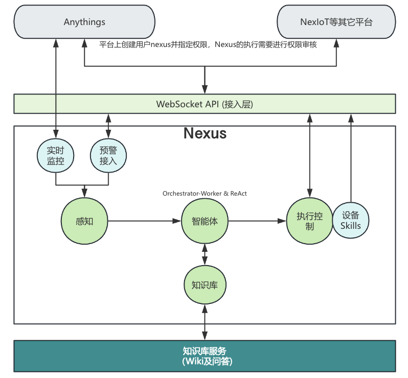
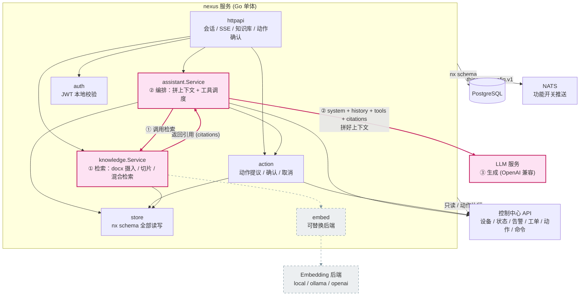
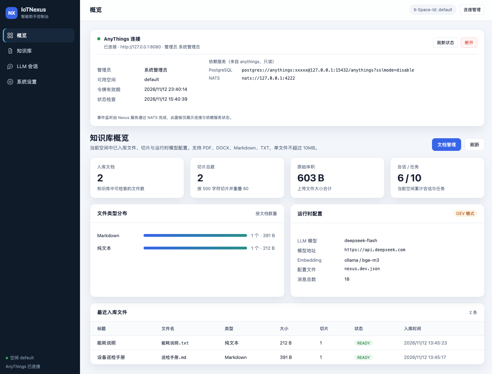
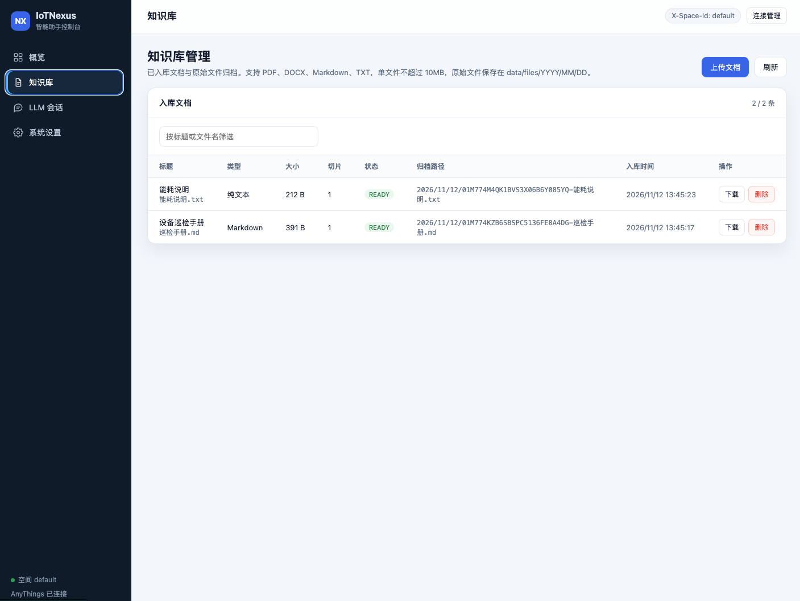
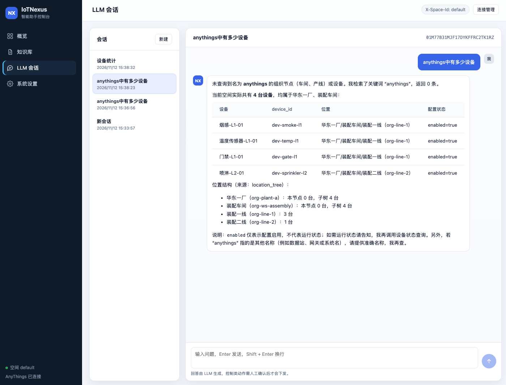
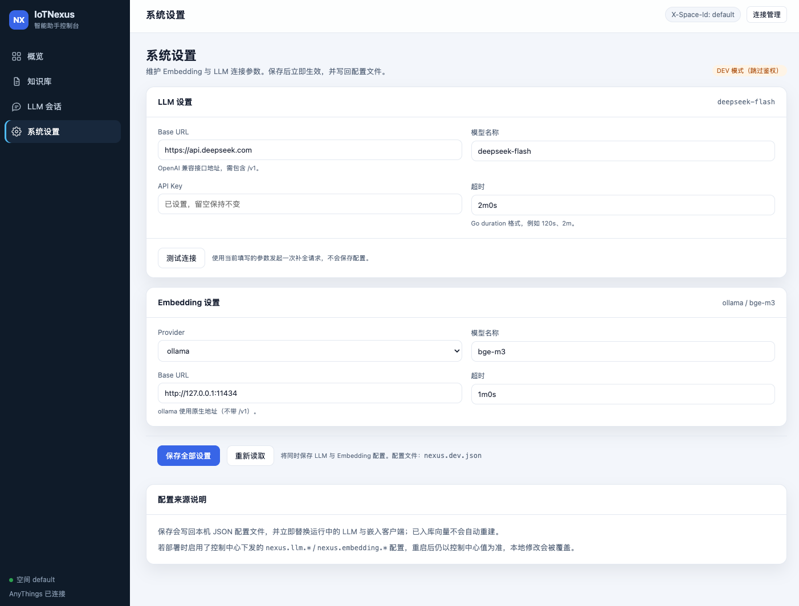

# IoTNexus —— IoT知识库与智能助手服务

<p align="center" width="128">
  
</p>

## 定位

IoTNexus 是可以通过WS通道接入的独立 Go 微服务，提供**会话式查询、知识库检索与人工确认式控制**三类能力。它不进入毫秒级实时控制回路，也不替代IoT平台的设备管理、规则引擎与命令状态机；所有控制动作都走「动作意图 → 用户确认 → CC 命令」的链路，只做增量。

## 业务设计



IoT平台可以在内部创建特定的用户(如`nexus`)，并分配系统内的执行权限。按照Nexus的WebSocket API接入，包括告警事件、设备状态、动作提议等，并且需要响应Nexus执行请求。

## 架构总览



**RAG 三要素**：`knowledge.Service` 负责**检索**（docx 摄入、切片、向量+关键词混合检索），`assistant.Service` 负责**编排**（系统提示、工具调度、把 citations 拼进上下文），`LLM` 负责**生成**。灰色虚线表示 **`EMBED_SVC` 只是检索侧的可替换后端**（local / ollama / openai 三选一），与 RAG 主体解耦。

**当前实现是一个单体 Go 服务**，各层以包边界隔离。Agent 层、知识层、记忆层全部在同一进程内运行；异步触发（告警自动创建任务）尚未实现。


各模块依赖方向：

| 模块 | 依赖 | 被依赖 |
| --- | --- | --- |
| `httpapi` | assistant, action, knowledge, store, auth, FeatureGate | main |
| `assistant` | model, cc, knowledge, action, store | httpapi, main |
| `action` | cc, store | assistant, httpapi, main |
| `knowledge` | embed, store | assistant, httpapi, main |
| `cc` | 无（纯 HTTP 客户端） | assistant, action, FeatureGate |
| `model` | 无（纯 HTTP 客户端） | assistant |
| `embed` | 无（本地/远程嵌入） | knowledge |
| `store` | pgx（DB 客户端） | assistant, action, knowledge, httpapi |
| `auth` | jwt（本地 JWT 解析） | httpapi |

## UI

* Overview



* Knowledge



* Chat



* Settings




## 与其它模块的交互

### 与控制中心（CC）的交互

CC 是 nexus 的**唯一外部事实源**。所有设备、告警、工单、动作、命令的读写都走 CC 的 HTTP API，从不直接读 `cc.*` 表。

| 交互方向 | CC 接口 | nexus 调用点 | 说明 |
| --- | --- | --- | --- |
| 读 | `GET /api/v1/devices` | `cc.Client.Devices` | 分页拉取空间全部设备 |
| 读 | `GET /api/v1/devices/{id}` | `cc.Client.Device` | 查单个设备详情 |
| 读 | `GET /api/v1/device-status/tree` | `cc.Client.DeviceStatusTree` | 设备状态树（prefetch + 工具） |
| 读 | `GET /api/v1/alarms?status=active` | `cc.Client.Alarms` | 活动告警（prefetch + 工具） |
| 读 | `GET /api/v1/work-orders` | `cc.Client.WorkOrders` | 工单查询 |
| 读 | `GET /api/v1/gateways` | `cc.Client.Gateways` | 网关查询 |
| 读 | `GET /api/v1/endpoints` | `cc.Client.Endpoints` | 端点查询 |
| 读 | `GET /api/v1/devices/{id}/dynamics` | `cc.Client.DeviceDynamics` | 设备动态值 |
| 读 | `GET /api/v1/org-nodes` | `cc.Client.OrgNodes` | 组织树（用于 location 合成） |
| 读 | `GET /api/v1/devices/{id}/actions` | `cc.Client.DeviceActions` | 设备可用动作定义 |
| 读 | `GET /api/v1/data/latest` | `cc.Client.DataLatest` | 测点最新值 |
| 读 | `GET /api/v1/data/series` | `cc.Client.DataSeries` | 历史时序（支持聚合） |
| 写 | `POST /api/v1/devices/{id}/actions/{code}/execute` | `cc.Client.ExecuteAction` | 用户确认后创建 CC 命令（幂等键 = proposal_id） |
| 内部读 | `GET /internal/v1/system/config/{key}` | `cc.Client.FeatureEnabled` | 服务身份读取功能开关 |

所有 CC 请求透传用户 JWT 和 `X-Space-Id` 头，CC 负责鉴权与空间隔离。**幂等性**由 CC 的 `(space_id, idempotency_key)` 唯一索引保证，nexus 用 `proposal_id` 作为幂等键重复确认不会产生新命令。

HTTP 客户端实现细节：读请求自动重试 3 次（200ms / 400ms 退避），写请求不重试（避免重复提交），单次请求超时 20s（适配时序查询跨 90 天最多 20 端点）。

### 与 NATS 的交互

nexus 仅**订阅**一个 NATS 主题：`things.nx.config.v1`。

用途是功能开关的实时推送：管理员在 CC 系统设置里修改 `system.nx_assistant_enabled` 后，CC 发布事件，nexus 的 FeatureGate 立即刷新缓存，无需等待 TTL 到期。冷启动时先调用 CC 内部 API 拉一次初值，再订阅推送。

```go
// server.go FeatureGate.Sync
conn.Subscribe("things.nx.config.v1", func(msg *nats.Msg) {
    // {key, value} 事件，匹配 feature_key 后 set(value)
})
```

NATS 连接参数：`nats://127.0.0.1:4222`，无限重连，默认不配置 NATS 也能跑（降级为 TTL 轮询）。

### 与模型服务的交互

| 服务 | 协议 | 接口 | 说明 |
| --- | --- | --- | --- |
| LLM | OpenAI Chat Completions | `POST {base_url}/chat/completions` | 非流式、带 tools、支持 tool_choice 强制工具选择 |
| Embedding | Provider 三选一 | `Embed([texts]) → [[]float32]` | `local`（onnxruntime）/ `ollama`（HTTP）/ `openai`（HTTP） |

模型客户端只实现 `chat/completions`，不实现 streaming —— 流式输出由 nexus 侧用非流式返回结果后按 runes 分片模拟。Tool call 定义直接内嵌在 assistant service 中，15 个工具随 system prompt 一起发送给模型。

### 与前端的交互

前端嵌入 anythings 管理端侧边栏，路由 `/assistant`。所有 API 复用 CC 签发的 JWT，HTTP 层用 `X-Space-Id` 头做空间隔离。

**API 列表：**

| 方法 | 路径 | 权限 | 说明 |
| --- | --- | --- | --- |
| GET | `/healthz` | — | 健康检查 |
| POST | `/api/v1/nx/sessions` | `nx:chat:use` | 创建会话 |
| GET | `/api/v1/nx/sessions` | `nx:task:read` | 列出我的会话 |
| GET | `/api/v1/nx/sessions/{id}/messages` | `nx:task:read` | 拉会话消息历史 |
| POST | `/api/v1/nx/chat` | `nx:chat:use` | SSE 流式对话 |
| GET | `/api/v1/nx/tasks/{id}` | `nx:task:read` | 任务详情 |
| GET | `/api/v1/nx/tasks/{id}/trace` | `nx:task:read` | 任务轨迹（events + steps） |
| GET | `/api/v1/nx/kb/documents` | `nx:knowledge:read` | 知识文档列表 |
| POST | `/api/v1/nx/kb/documents` | `nx:knowledge:write` | 上传文档（支持 pdf / docx / md / txt，≤ 10MB），原始文件归档到 `data/files` |
| GET | `/api/v1/nx/kb/documents/{id}/download` | `nx:knowledge:read` | 下载归档的原始文件 |
| DELETE | `/api/v1/nx/kb/documents/{id}` | `nx:knowledge:write` | 删除文档、切片与原始文件 |
| GET | `/api/v1/nx/actions/{id}` | `nx:task:read` | 动作提议详情 |
| GET | `/api/v1/nx/actions/{id}/audit` | `nx:task:read` | 动作审计日志 |
| POST | `/api/v1/nx/actions/{id}/confirm` | `nx:action:execute` | 确认动作（触发 CC 命令） |
| POST | `/api/v1/nx/actions/{id}/cancel` | `nx:action:execute` | 取消动作 |
| GET | `/api/v1/nx/console/dashboard` | `nx:task:read` | WebUI 概览：知识库、会话、任务统计 |
| GET | `/api/v1/nx/console/settings` | `nx:system:write` | 读取 LLM / Embedding 设置 |
| PUT | `/api/v1/nx/console/settings` | `nx:system:write` | 保存设置并热切换客户端 |

**SSE 事件类型：**

| 事件 | 载荷 | 时机 |
| --- | --- | --- |
| `task.updated` | `{task_id, status, round_no}` | 任务创建 / 每轮完成 |
| `tool.call` | `{stage, tool, args}` / `{stage, tool, summary}` | 工具调用开始 / 结束 |
| `action.proposed` | 完整 ActionProposal | 模型生成动作意图 |
| `message.delta` | `{content}` | 答案流式分块推送 |
| `answer.completed` | `{message_id, task_id, content, citations, action_proposals, status}` | 任务成功 |
| `error` | `{code, message}` | 任务失败 |

### 内置 WebUI 控制台

`webui/` 是独立的 Vue 3 + Vite 应用，构建后通过 `go:embed` 打进二进制，由 nexus 直接托管在 `/`；开发时走 Vite（5173）并把 `/api` 代理到 nexus（8088）。

| 页面 | 路由 | 能力 |
| --- | --- | --- |
| 概览 | `/` | 知识库文档数、切片数、体积、类型分布、最近入库文件、运行时模型摘要 |
| 文档 | `/documents` | 文档列表与筛选、上传入库、下载原始文件、删除（含切片与归档文件） |
| LLM 会话 | `/chat` | 会话列表、流式对话、工具调用轨迹、引用来源、动作提议确认/取消 |
| 系统设置 | `/settings` | 查看/修改 LLM 与 Embedding 参数，保存后写回配置文件并热切换客户端 |

生产环境复用 CC 签发的 JWT：页面右上角「连接设置」填入 Token 与空间 ID，请求携带 `Authorization` 与 `X-Space-Id`。本地 `dev_mode` 下跳过鉴权，可直接使用。

## 安全与权限

**认证**：所有 HTTP 请求携带 `Authorization: Bearer <JWT>`，由 nexus 用与 CC 共享的密钥本地校验 HS256 签名。JWT Claims 包含 `username / roles / space_ids / permissions`，签发者固定为 `anythings-control-center`。

**权限校验**：`httpapi.authed(permission, next)` 中同时校验：
1. JWT 签名、签发者、有效期
2. `X-Space-Id` 头存在且 `claims.AllowsSpace(spaceID)` 为真（跨空间由 `*:*:*` 管理员放行）
3. FeatureGate 开关打开（关闭时返回 404 `NX_FEATURE_DISABLED`）
4. `claims.HasPermission(permission)` —— 权限匹配支持 `{域}:{动作}:{资源}` 任一段通配符，例如 `nx:*:*` 放行所有 nx 操作

**审计**：动作提议、确认、取消都会写 `nx.audit_log`，记录 actor / action / resource / result / detail / timestamp。

**风险等级推断**：当前没有从动作定义读取风险字段，而是启发式：`requires_approval = L3`，`executor = gpio → L2`，其余 L1。

## 配置

完整配置结构见 `nexus.example.json`，支持环境变量覆盖（`ANYTHINGS_NEXUS_*` 前缀）：

| 字段 | 默认 | 说明 |
| --- | --- | --- |
| `http_addr` | `:8088` | HTTP 监听地址 |
| `pg_dsn` | — | **必填**，PostgreSQL 连接串 |
| `migrations_dir` | `migrations` | 迁移文件目录 |
| `data_dir` | `data` | 数据根目录：日志与知识库原始文件归档 `files/YYYY/MM/DD` |
| `nats_url` | `nats://127.0.0.1:4222` | NATS 地址（空则降级为 TTL 轮询） |
| `cc_base_url` | `http://127.0.0.1:8080` | 控制中心地址 |
| `cc_service_token` | — | 服务身份令牌，用于读内部配置 |
| `jwt_secret` | — | **必填**，与 CC 共享的 HS256 密钥 |
| `jwt_issuer` | `anythings-control-center` | JWT 签发者 |
| `feature_key` | `system.nx_assistant_enabled` | 功能开关配置键 |
| `feature_cache_ttl` | `30s` | FeatureGate 刷新周期 |
| `model` | — | LLM 配置（base_url / model / api_key / timeout） |
| `embedding` | — | 嵌入配置（provider: local/ollama/openai） |
| `assistant` | — | 任务预算：max_rounds=12, max_tool_calls=30, max_duration=300s, max_history_messages=20 |
| `log_level` | `info` | debug / info / warn / error |
| `dev_mode` | `false` | 本地联调开关：跳过 JWT 与功能开关校验，**禁止在生产开启** |
| `dev_user_id` | `dev-user` | dev 模式下的模拟用户 |
| `dev_space_id` | `dev-space` | dev 模式下的默认空间 |
